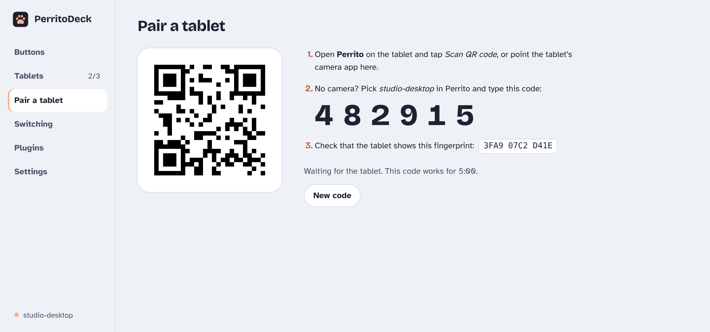
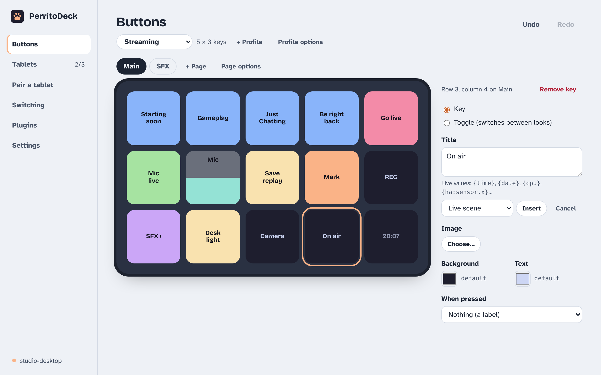
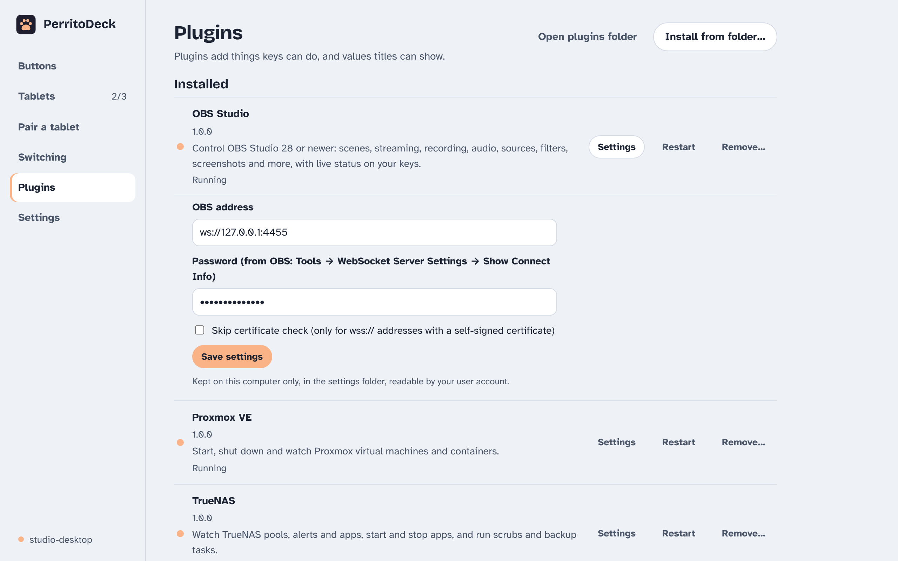

<p align="center"></p>

# PerritoDeck

**Turn an old Android tablet or phone into a Stream Deck–style control surface for Windows, macOS and Linux.** Free and open source, with no account and no cloud.

> El gato has a deck. Now the perrito does too.

PerritoDeck has two parts:

- **PerritoDeck** on your computer: a tray app where you lay out buttons by dragging, and the host that draws them and runs their actions.
- **Perrito** on the tablet: a full-screen grid of live buttons and sliders. It runs on Android 5.1 and newer, including Amazon Fire tablets. An iPhone/iPad version is coming.

**Status: pre-alpha.** It works end to end and is tested in CI on emulators, but there's no published release yet. Expect rough edges and breaking changes. The [roadmap](docs/plan/) shows what's done.

## Screenshots

<!-- TODO: screenshots are being finalised in docs/assets/ (light and *-dark variants).
     Swap or reorder these once they're final. -->

<p>
  <picture>
    <source media="(prefers-color-scheme: dark)" srcset="docs/assets/screenshot-buttons-dark.png">
    
  </picture>
  <picture>
    <source media="(prefers-color-scheme: dark)" srcset="docs/assets/screenshot-pair-dark.png">
    
  </picture>
  <picture>
    <source media="(prefers-color-scheme: dark)" srcset="docs/assets/screenshot-live-values-dark.png">
    
  </picture>
  <picture>
    <source media="(prefers-color-scheme: dark)" srcset="docs/assets/screenshot-plugins-dark.png">
    
  </picture>
</p>

## Features

- **Drag-and-drop editor** that mirrors your tablet's grid: pages, copy/paste, undo/redo, and a "Try it" button. Edits show up on the tablet as you make them.
- **Actions:** hotkeys (recorded by pressing them), typing text, media keys, opening websites, files and programs, running commands, multi-step keys and toggles.
- **Built-in integrations:** OBS Studio and Home Assistant.
- **Sliders** for system volume, Home Assistant light brightness, OBS audio sources, or any program.
- **Live keys:** CPU, memory, Home Assistant states, OBS scene and recording status, and values from plugins; toggles can follow them. Animated GIF icons.
- **Profiles** per tablet, switched automatically by the app in front (Windows, macOS and Linux on X11). Export and import as `.perritoprofile` files.
- **Plugins** in Python or Node.js, with 13 first-party ones (HTTP, MQTT, Now playing, OBS, timers, counters, Wake-on-LAN, weather, Ollama, Proxmox, TrueNAS, GitLab, uptime checks) and an online catalogue.
- **Experimental:** run many Stream Deck plugins (`.sdPlugin`, Node.js), and act as a Bitfocus Companion Satellite surface.
- **Private by design:** pairing with a one-time code or QR, TLS with a pinned certificate, Wi-Fi or a USB cable. No telemetry. The app itself only goes online for the update check and the plugin catalogue, both opt-in.
- **Command-line host** for headless machines, and `fakedeck`, a test client that needs no tablet.

Not there yet: the iOS app (written, not yet built), dials and touch strips as separate controls, plugins drawing their own key images, and signed installers.

## Install

The first release isn't out yet. When it is, everything will be on the
[download page](https://perritodeck.dev/download.html) and on
[GitHub Releases](https://github.com/perritodeck/perritodeck/releases):

- **Windows** (installer or MSI), **macOS** (universal `.dmg`), **Linux** (AppImage, `.deb`, `.rpm`; Flatpak and AUR later)
- **Perrito for Android** as an APK, then on F-Droid, IzzyOnDroid and Google Play

Until then, build from source (below).

## Quick start

1. Start **PerritoDeck** on your computer. It lives in the tray (menu bar on a Mac).
2. Open **Perrito** on the tablet. It finds your computer on the local network.
3. Choose **Pair a tablet** in the tray menu and scan the QR code with the tablet, or type the 6-digit code.
4. Drag actions onto keys in the editor. They appear on the tablet straight away.

The [user guide](https://perritodeck.dev/guide/) ([source](website/guide/)) covers
[getting started](website/guide/getting-started.html), [buttons](website/guide/buttons.html),
[integrations](website/guide/integrations.html), [plugins](website/guide/plugins.html) and
[troubleshooting](website/guide/troubleshooting.html).

### From source

You need Rust (the version in `host/rust-toolchain.toml` installs itself), Node.js 22+
for the desktop app, and JDK 17 for Android.

```sh
# Command-line host: prints a pairing code and QR
cd host && cargo run -p perritodeck-host -- --pair

# No tablet? Pair the test client with that code and watch the layout
cargo run -p perritodeck-fakedeck -- pair <code>
cargo run -p perritodeck-fakedeck -- watch

# Desktop app
cd host/app && npm ci && npx tauri dev

# Android app (debug APK in android/app/build/outputs/apk/)
cd android && ./gradlew assembleDebug
```

[CONTRIBUTING.md](CONTRIBUTING.md) lists the test commands for every part.

## Repository layout

| Path | What |
|---|---|
| [`host/`](host/) | Desktop host in Rust: the command-line host and shared crates, and the tray app in [`host/app/`](host/app/) (Tauri 2 + Svelte 5) |
| [`android/`](android/) | Perrito for Android (Kotlin + Jetpack Compose) |
| [`ios/`](ios/) | Perrito for iPhone and iPad (SwiftUI), not yet built |
| [`protocol/`](protocol/) | Wire protocol: JSON schema and golden fixtures |
| [`plugins/`](plugins/) | Plugin SDKs and first-party plugins (MIT) |
| [`website/`](website/) | [perritodeck.dev](https://perritodeck.dev) and the user guide |
| [`docs/`](docs/) | [Architecture](docs/ARCHITECTURE.md), [decisions](docs/DECISIONS.md), [roadmap](docs/plan/), [security model](docs/SECURITY.md) |

## Plugins

Plugins are ordinary programs the host talks to over stdin/stdout, so you can write one
in any language. The [Python and Node.js SDKs](plugins/README.md) do the protocol work for
you; [plugins/PROTOCOL.md](plugins/PROTOCOL.md) documents it. The SDKs are MIT-licensed,
so your plugin can use any licence.

## Contributing

Bug reports, plugin ideas and pull requests are welcome. Read [CONTRIBUTING.md](CONTRIBUTING.md)
(we use DCO sign-off, and never take code from GPL projects) and the
[Code of Conduct](CODE_OF_CONDUCT.md). Please report security problems privately as
described in [SECURITY.md](SECURITY.md).

## Licence

PerritoDeck is licensed under the [Apache License 2.0](LICENSE). The plugin SDKs and
first-party plugins in [`plugins/`](plugins/) are under the [MIT License](plugins/LICENSE).
Third-party components and their licences are listed in
[THIRD_PARTY_NOTICES.md](THIRD_PARTY_NOTICES.md).

Copyright PerritoDeck contributors. Not affiliated with Elgato, Corsair or Bitfocus.
"Stream Deck" is a trademark of Corsair Memory, Inc., used here only to describe compatibility.
